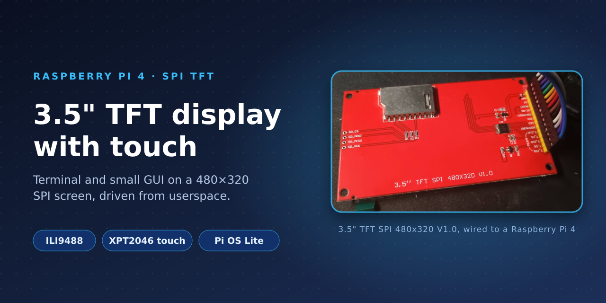
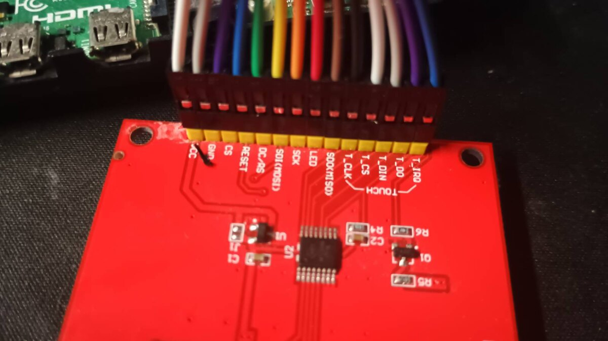
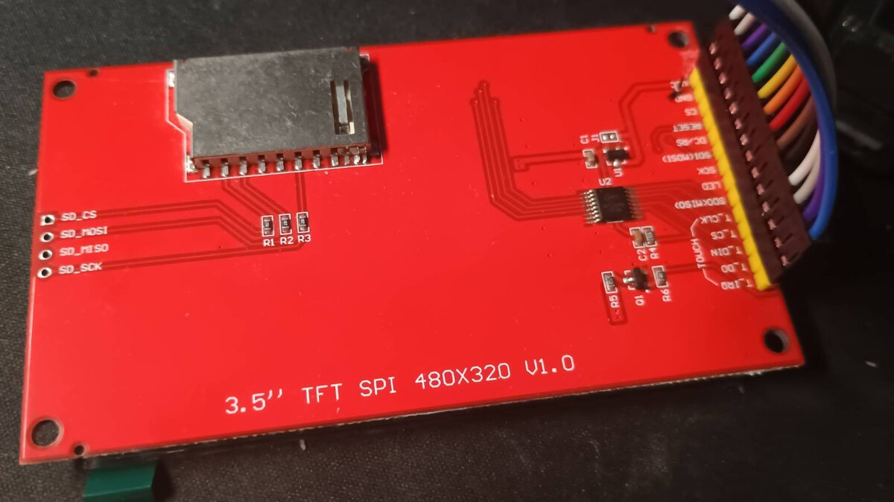
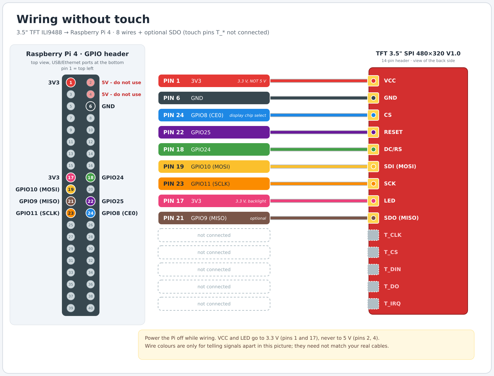
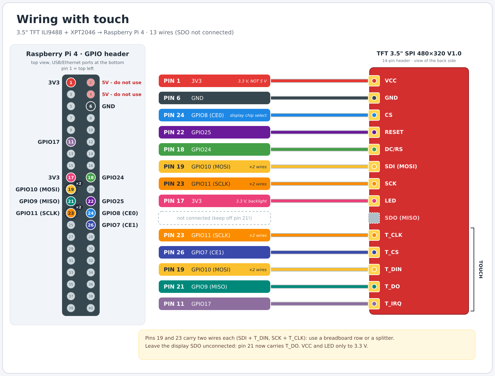

<p align="center">
  
</p>

# Raspberry Pi 4 + 3.5" TFT SPI (480x320), with or without touch

A cheap Chinese 3.5" SPI TFT ("3.5'' TFT SPI 480X320 V1.0", ILI9488 + XPT2046 touch) driven by a Raspberry Pi 4 (8 GB).
It shows a **terminal** or a **small desktop (GUI)** on the 480x320 screen, with keyboard, mouse and optional **touch**.

**Contents:** [Status](#status) · [How it works](#how-it-works) · [Hardware](#hardware) ·
[Build A: without touch](#build-a-without-touch) · [Build B: with touch](#build-b-with-touch) ·
[Switching between A and B](#switching-between-a-and-b) · [Usage](#usage) · [Troubleshooting](#troubleshooting) ·
[Project layout](#project-layout) · [Open ideas](#open-ideas)

## Status

2026-10-19.

| Part | State |
|---|---|
| Display (colours, picture) | works (ILI9488 init, 18-bit colour over SPI) |
| Terminal mode + small GUI mode | works, switch by command or hotkey |
| Physical keyboard / mouse into the screen | works |
| Touch (finger / stylus) | works; stylus is more precise. Calibrate once with `sudo tftcal` |
| Fresh install from scratch with `tft/install.sh` | not tested end to end (pieces were installed one by one), so expect to debug small things |
| Build A (no touch wiring) with `TFT_TOUCH=off` | written, not tested on hardware |
| Visible mouse cursor on the screen | missing (Xvfb framebuffer has no cursor) |

## How it works

### The problem
- The ILI9488 panel speaks only **18-bit colour over 4-wire SPI** (3 bytes per pixel), and stock Raspberry Pi OS has no
  driver or overlay for it (the usual `fbtft`/`mipi-dbi` init assumes 16-bit colour and gives garbage).
- `fbcp-ili9341` (copy the HDMI framebuffer to the display) depends on DispmanX, which is gone on current Pi OS.
- The kernel `ads7846` touch overlay did not work here (see [Troubleshooting](#troubleshooting)).

So everything runs in **userspace**, on a **virtual X screen**.

### Data flow
```
                      Xvfb :1  (virtual 480x320 screen, 32 bit)
                     /                      ^
   -fbdir /dev/shm/tft                      | XTEST (fake keyboard / pointer events)
   (screen as a mmapped XWD file)           |
                     v                      |
  tftd.py  --SPI0, CE0, 32 MHz-->  ILI9488  |        inputd.py  <-- keyboard / mouse (evdev, /dev/input/event*)
  (changed rectangle only, 30 fps)          |                   <-- touch  (xpt2046.py, SPI0 CE1, 1 MHz, polled every 10 ms)
                                            +-------------------  Ctrl+Alt+F1 / F2 call `tftmode`
```

### Display path (`tftd.py`)
1. **Xvfb** is started with `-fbdir /dev/shm/tft`, which makes it keep the whole screen in a file
   (`Xvfb_screen0`, XWD format, in RAM). `tftd` memory-maps it and reads the header to find where the pixels start.
2. Every frame (30 per second) it takes a snapshot, compares it with the previous one and computes the **bounding
   rectangle of what changed** (rows and columns). Only that rectangle is sent. The first frame is sent in full.
3. Pixels are BGRX in the file; they are reordered to RGB and sent as **3 bytes per pixel** (the ILI9488 uses the upper
   6 bits of each byte).
4. SPI protocol: command bytes go out with the **DC pin (GPIO24) low**, data with DC high. `0x2A`/`0x2B` set the
   column/row window, `0x2C` starts memory write. Reset is a pulse on **GPIO25**.
5. **Init sequence** (the one that worked): software reset, sleep out, gamma tables, power/VCOM, `0x36` memory access
   control (rotation/mirroring, BGR), **`0x3A = 0x66` (18-bit colour)**, frame rate, inversion, display on.
6. The chip select (GPIO8 / CE0) is owned by the kernel SPI driver, so userspace cannot toggle it by hand; every
   `writebytes` call asserts it itself, which is fine for writes. This is also why reading registers (`read_id.py`)
   returned only zeros.

### Input path (`inputd.py`)
- **Keyboard and mouse:** reads `/dev/input/event*` with `evdev`, injects them into Xvfb with the **XTEST** extension
  (Xvfb has no input devices of its own, which is why the keyboard typed nothing at first). X keycodes are Linux
  keycodes + 8, so no keymap is needed; the layout is set with `setxkbmap` from `KBD_LAYOUT`.
- **Mode hotkeys:** Ctrl+Alt+F1 runs `tftmode terminal`, Ctrl+Alt+F2 runs `tftmode gui`, so you can switch without SSH.
- **Touch (`xpt2046.py`)**: instead of the kernel driver, the XPT2046 is read directly over `/dev/spidev0.1`
  (touch chip select T_CS on CE1). It does **not need the T_IRQ pin**: touch is detected from **pressure**,
  `z = z1 + 4095 - z2` (about 0 when untouched). X and Y are the median of three conversions each.
  Readings pinned at the ADC limits (outside 100..4000, typical at finger lift) are dropped. A touch starts after
  2 consecutive polls above the threshold (`TFT_TOUCH_Z`, default 400) and ends after 3 below it.
- **Calibration:** raw 12-bit coordinates are mapped to pixels by an affine transform
  `sx = a*rx + b*ry + c`, `sy = d*rx + e*ry + f`, stored in `/etc/default/tft-touch.json` and reloaded on every new touch.
  `calibrate.py` (`sudo tftcal`) shows 4 crosses (40 px from the corners), takes the median raw point of each tap and
  fits the six numbers by least squares, which also handles swapped or mirrored axes. It prints the worst error in pixels.
- Touch becomes an **absolute pointer move + button 1 press/release** in Xvfb, so GUI programs see an ordinary mouse.

### Modes and services (systemd)
A **mode** is just what runs on the virtual screen:

| Mode | What runs |
|---|---|
| terminal | `xterm` 80x24 (6x13 font fits 480x312 px exactly) running a login shell of the Pi user |
| gui | Openbox window manager + tint2 panel + an xterm |

| Service | Role |
|---|---|
| `tft-xvfb` | the virtual screen |
| `tftd` | mirrors it to the display |
| `tft-input` | keyboard / mouse / touch forwarding |
| `tft-mode-terminal` (enabled at boot) / `tft-mode-gui` | the two modes; they conflict, so only one runs |

`tftmode <mode>` stops both modes, restarts `tft-xvfb` and `tftd` (clean screen), waits a second and starts the chosen mode.
`tft-input` keeps running and reconnects to X by itself.

Config lives in `/etc/default/tft`: `KBD_LAYOUT=us` and `TFT_TOUCH=on|off`.

## Hardware

- Raspberry Pi 4 Model B, 8 GB. OS: Raspberry Pi OS Lite 64-bit (Trixie), kernel 6.18.50+rpt-rpi-v8,
  host `raspberry4`, user `makrela`, IP 192.168.0.176 (SSH works; Tailscale was recommended, not set up yet).
- 3.5" TFT SPI module, 480x320, red PCB, a single **14-pin header** (does not plug onto the Pi, needs jumper wires).
  Probably a clone of the LCDWiki MSP3520/MSP3521 family. It has an on-board 3.3 V regulator and a micro-SD slot whose pads
  are not routed to the header (slot unusable).
- The exact seller listing is unknown. Similar 14-pin ILI9488 + XPT2046 modules exist (for example Elecrow DLS24035B), consistent with what was measured.
- **LCD controller: ILI9488 (compatible)**, confirmed by the working init. **Touch: XPT2046, resistive**; a stylus came with it.

Display header, left to right as printed on the board:
`VCC, GND, CS, RESET, DC/RS, SDI(MOSI), SCK, LED, SDO(MISO), T_CLK, T_CS, T_DIN, T_DO, T_IRQ`

<table>
  <tr>
    <td width="50%"></td>
    <td width="50%"></td>
  </tr>
  <tr>
    <td align="center"><sub>The 14-pin header and its silkscreen labels (VCC ... T_IRQ)</sub></td>
    <td align="center"><sub>Back of the board: micro-SD slot (unused), U2 touch chip, "3.5'' TFT SPI 480X320 V1.0"</sub></td>
  </tr>
</table>

Pi pin numbers below are **physical header pins**. Pins 19, 21, 23 and 24 are the SPI0 bus; pin 26 is the second chip select.

## Build A: without touch

Use this if you do not need touch, or as a first step before adding touch. **8 wires** (a 9th, SDO, is optional and not needed).

### A1. Wiring (Pi powered off, USB-C unplugged)

| Display | Pi pin | Pi GPIO |
|---|---|---|
| VCC | 1 | 3V3 |
| GND | 6 | GND |
| LED | 17 | 3V3 |
| DC/RS | 18 | GPIO24 |
| SDI (MOSI) | 19 | GPIO10 |
| RESET | 22 | GPIO25 |
| SCK | 23 | GPIO11 |
| CS | 24 | GPIO8 (CE0) |

Rules: **VCC and LED to 3.3 V, never 5 V (pins 2 and 4)**; do not connect any `T_*` pins; SDO can stay unconnected.
Diagram (it also draws the optional SDO wire on pin 21):



Check twice, then: power on. The **backlight lights up white** straight away (LED pin is on 3.3 V); that only proves
power, not the data lines.

### A2. Prepare the Pi
1. Flash **Raspberry Pi OS Lite (64-bit)** with Raspberry Pi Imager; in its settings set hostname, user, password,
   Wi-Fi and **enable SSH**.
2. Boot, find the IP (router, `ping raspberrypi.local`) and log in: `ssh <user>@<ip>`.
3. `sudo apt update && sudo apt full-upgrade -y`

### A3. Install
From the laptop (adjust user and IP):
```bash
scp -r tft makrela@192.168.0.176:/home/makrela/
ssh makrela@192.168.0.176
cd ~/tft
sudo bash install.sh
sudo tfttouch off          # no touch wiring: stop the touch chip being polled
sudo reboot
```
`install.sh` installs the packages (Xvfb, xterm, Openbox, tint2, Python libs), **enables SPI** (`raspi-config nonint
do_spi 0`), copies the programs to `/opt/tft/`, creates the systemd services and the `tftmode`, `tfttouch`, `tftcal`
commands. Errors from `tftd` before the first reboot are normal: SPI only appears after a reboot.

### A4. Check
After the reboot (about 20 to 30 seconds):
1. `ls /dev/spidev*` shows `/dev/spidev0.0` (and `0.1`).
2. The display shows a **black terminal with a shell prompt**.
3. Type on a keyboard plugged into the Pi: letters appear. Try `sudo tftmode gui`, then Ctrl+Alt+F1 to come back.
4. Status: `systemctl status tftd tft-xvfb tft-input --no-pager`; logs: `journalctl -u tftd -n 30`.

Independent hardware test (without the services): `sudo systemctl stop tftd && sudo python3 ~/fill_test.py`
(copy `fill_test.py` over first). The screen should flash red, green, blue. Start `tftd` again afterwards.

Picture mirrored or upside down: edit the `ExecStart` of `tftd.service` and add `--madctl 0x68` (then `0xA8`, `0xE8`).

## Build B: with touch

Everything from Build A, plus the touch wiring and a calibration. **13 wires.**

### B1. Wiring (Pi powered off)
Start from Build A and add:

| Display | Pi pin | Pi GPIO | Note |
|---|---|---|---|
| T_CS | 26 | GPIO7 (CE1) | touch chip select |
| T_CLK | 23 | GPIO11 | **same pin as SCK: two wires** |
| T_DIN | 19 | GPIO10 | **same pin as SDI: two wires** |
| T_DO | 21 | GPIO9 (MISO) | touch data out |
| T_IRQ | 11 | GPIO17 | optional, **not used** by the current software |

- **SDO must NOT be connected** to pin 21 (T_DO uses it; the LCD's SDO may not release the line).
- Pins 19 and 23 get **two wires each**: use a breadboard row or a splitter; two Dupont connectors do not fit on one pin.



### B2. Install
If this is a fresh Pi, follow A2 and A3 but run `sudo tfttouch on` (or skip it, `on` is the default) instead of `off`.
If you already have Build A running, only add the wires, then:
```bash
sudo tfttouch on
ls /dev/spidev*            # expect spidev0.0 and spidev0.1
```
If the Pi was set up earlier with the old kernel touch overlay (`ads7846`), run `sudo bash ~/tft/touch-userspace.sh`
and reboot; it removes the overlays that hide `/dev/spidev*`.

### B3. Test the raw touch
```bash
sudo systemctl stop tft-input
sudo TFT_DEBUG=1 python3 -u /opt/tft/inputd.py
```
Touch the screen with a finger or stylus. You should see lines like
`xpt2046 raw=(3197,2788) z=851 pressed=True` while touching and `pressed=False` otherwise.
Stop with Ctrl+C and run `sudo systemctl start tft-input`.
- **No lines at all:** the chip is not answering; check T_CS (26), T_DO (21), T_DIN (19), T_CLK (23) and that SDO is off pin 21.
- **Lines appear without touching, or touches are missed:** set `TFT_TOUCH_Z` (for example 300 or 600) in the
  environment of `tft-input`; the `z` value in the debug output shows idle vs. pressed.

### B4. Calibrate
```bash
sudo tftcal
```
Four white crosses appear on the display. Tap each centre in turn, preferably with a **stylus**. The command prints
`Saved. Max error N px`; a few pixels up to about 8 to 10 px is normal for a resistive panel. The result is saved in
`/etc/default/tft-touch.json` and used immediately. Then try `sudo tftmode gui` and tap around.

## Switching between A and B

| Change | What to do |
|---|---|
| B -> A (remove touch) | unplug the T_* wires, `sudo tfttouch off` |
| A -> B (add touch) | power off, remove SDO from pin 21 if present, add the wires from B1, `sudo tfttouch on`, `sudo tftcal` |

## Usage

| Task | Command |
|---|---|
| Terminal mode (default at boot) | `sudo tftmode terminal` |
| GUI mode | `sudo tftmode gui` |
| Switch on the Pi's own keyboard | **Ctrl+Alt+F1** = terminal, **Ctrl+Alt+F2** = GUI |
| Touch on / off | `sudo tfttouch on` / `off` |
| Calibrate touch | `sudo tftcal` |
| Keyboard layout | `KBD_LAYOUT=` in `/etc/default/tft` (`us`, `sk`, `cz`), then `sudo tftmode <mode>` |
| Picture rotated / mirrored | `tftd.py --madctl 0x28` (try `0x68`, `0xA8`, `0xE8`) |
| SPI speed | `tftd.py --speed 32000000` (lower it if the picture has artefacts) |
| Update after editing the files | `cd ~/tft && sudo bash install.sh` (safe to re-run), or copy single files to `/opt/tft/` and `sudo systemctl restart tftd tft-input` |

The terminal is an `xterm` of the Pi user, not the real tty1 console.

## Troubleshooting

Things that actually happened:

| Symptom | Cause | Fix |
|---|---|---|
| Plain white screen, only backlight | `tftd` crashes: `/dev/spidev0.0` missing | `ls /dev/spidev*`, `journalctl -u tftd`; need `dtparam=spi=on` and **no** `ads7846` overlay in `/boot/firmware/config.txt`; reboot after enabling SPI |
| `/dev/spidev*` vanish after adding touch | the kernel `ads7846` overlay disables spidev0 and takes CE1 | remove the overlay (`tft/touch-userspace.sh`); touch is read in userspace |
| Kernel touch device exists, `evtest` shows nothing | interrupt driven; GPIO17 (T_IRQ) never changed level, so the driver never saw pen-down, while the chip itself answered over SPI | userspace pressure polling (current design). `/sys/class/hwmon/hwmon2/temp0` changing proves the SPI link works |
| Keyboard types nothing in the terminal | Xvfb has no input devices | `inputd.py` forwards evdev events (`install.sh`) |
| `read_id.py` returns all zeros | SDO readback unusable on this module | not needed, ignore |
| Pointer jumps to a corner at finger lift | readings pinned at the ADC limits, e.g. `(0,4095)`, with low pressure | filtered in `xpt2046.py`, threshold 400 |
| Touch laggy / inaccurate | not calibrated; display used to send full rows | `sudo tftcal`; `tftd.py` now sends only changed rectangles |
| Phantom touches in Build A | touch not wired, the SPI line floats | `sudo tfttouch off` |
| `sudo` on the laptop rejects the right password | `pam_faillock`: 3 bad tries lock for about 10 min | wait, check with `faillock --user <name>` |

## Project layout

```
README.md                  this file
read_id.py                 tried to read the LCD ID registers (inconclusive, all zeros)
fill_test.py               ILI9488 init + red/green/blue fill: first proof the display works
image.png                  Raspberry Pi 4 GPIO pinout reference
diagrams/                  wiring diagrams (PNG + SVG): display only, display + touch
images/                    banner and real photos of the board
tft/
  install.sh               fresh install: apt deps, SPI on, systemd units, tftmode / tfttouch / tftcal
  tftd.py                  Xvfb screen -> ILI9488 over SPI (changed-rectangle updates)
  inputd.py                keyboard / mouse / touch -> Xvfb (XTEST), Ctrl+Alt+F1/F2 hotkeys
  xpt2046.py               XPT2046 reader over spidev0.1 (pressure based, no IRQ)
  calibrate.py             4-point touch calibration (writes /etc/default/tft-touch.json)
  touch-userspace.sh       only for a Pi that ran the old kernel-overlay setup: removes the overlays
  obsolete/                superseded attempts (kernel ads7846 overlay, spidev0 workaround), kept for reference
```

## Open ideas

- Draw a visible cursor (or touch feedback) on the mirrored screen.
- A real tty1 console instead of an xterm (needs a framebuffer path).
- Run `tftd` / `inputd` as a non-root user (currently root for SPI and evdev access).
- Lower latency: C implementation or a higher SPI clock if it still bothers.
- Verify `install.sh` end to end on a freshly flashed card; test Build A with `tfttouch off`.
- Tailscale for remote access.
